<!-- Gabriel Pessoa · Geospatial software & digital engineering -->
<div align="center">



<br/>

**BUILDING SOFTWARE FOR REAL-WORLD COMPLEXITY**

<sub>GEOSPATIAL TECHNOLOGY &nbsp; / &nbsp; AUTOMATION &nbsp; / &nbsp; DIGITAL PRODUCTS</sub>

<br/><br/>

[](https://github.com/gabriellpessoa)


</div>

---

### `01 / ABOUT`

I build and explore digital tools that connect **software engineering, geospatial information and workflow automation**.

My work is driven by a practical question: **how can technology make complex processes clearer, more reliable and easier to use?**

I am particularly interested in the intersection of spatial data, technical validation, application design and emerging AI capabilities.

### `02 / FOCUS AREAS`

<table>
  <tr>
    <td width="50%" valign="top">
      <b>◈ Geospatial systems</b><br/><br/>
      Spatial data workflows, technical analysis and geospatial tooling.
    </td>
    <td width="50%" valign="top">
      <b>⌘ Software development</b><br/><br/>
      Purpose-built applications, maintainable workflows and usability.
    </td>
  </tr>
  <tr>
    <td valign="top">
      <b>⚙ Automation & validation</b><br/><br/>
      Process automation, structured checks and repeatable operations.
    </td>
    <td valign="top">
      <b>✧ Applied AI & products</b><br/><br/>
      Exploring AI-assisted workflows and scalable digital products.
    </td>
  </tr>
</table>

### `03 / SELECTED WORK`

<table>
  <tr>
    <th align="left">INITIATIVE</th>
    <th align="left">DIRECTION</th>
  </tr>
  <tr>
    <td><b>ADAG GeoShift</b></td>
    <td>Geospatial data analysis and workflow automation.</td>
  </tr>
  <tr>
    <td><b>ADAG Modeler</b></td>
    <td>Technical modeling, validation and quality-oriented tooling.</td>
  </tr>
  <tr>
    <td><b>ADAG Topografia</b></td>
    <td>Digital initiatives related to surveying and geospatial practice.</td>
  </tr>
  <tr>
    <td><b>Altherys</b></td>
    <td>Exploration and development of digital applications and products.</td>
  </tr>
</table>

<sub>Selected work is maintained in private repositories. Descriptions provide a high-level overview only.</sub>

### `04 / CURRENT DIRECTION`

```text
> DESIGN      Tools that make complex information accessible
> ENGINEER    Reliable workflows and technical validation
> EXPLORE     Applied AI and product-oriented development
> IMPROVE     Quality, maintainability and user experience
```

### `05 / GITHUB`

<div align="center">

[](https://github.com/gabriellpessoa?tab=followers)
[](https://github.com/gabriellpessoa?tab=repositories)

<sub>Contribution activity and pinned repositories appear below this profile README.</sub>

</div>

---

<div align="center">

<sub>DESIGN WITH INTENTION. BUILD WITH PURPOSE.</sub>

**Gabriel Pessoa** &nbsp; · &nbsp; Brazil

<sub>Orbital artwork adapted from the open-source [original template](https://github.com/beydemirfurkan/awesome-github-profile/tree/main/templates/03-3d-immersive/tech-sphere).</sub>

</div>
